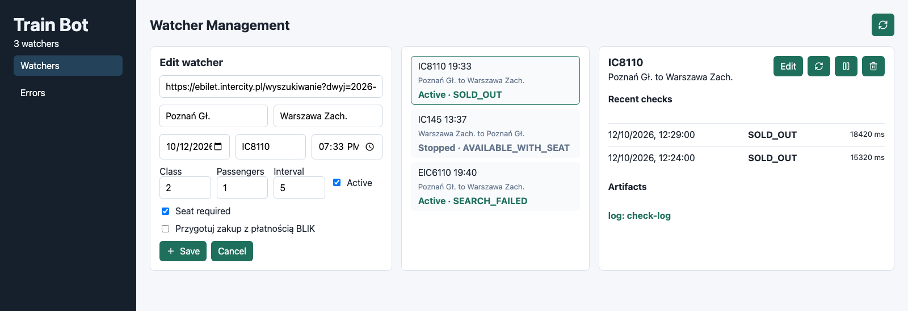
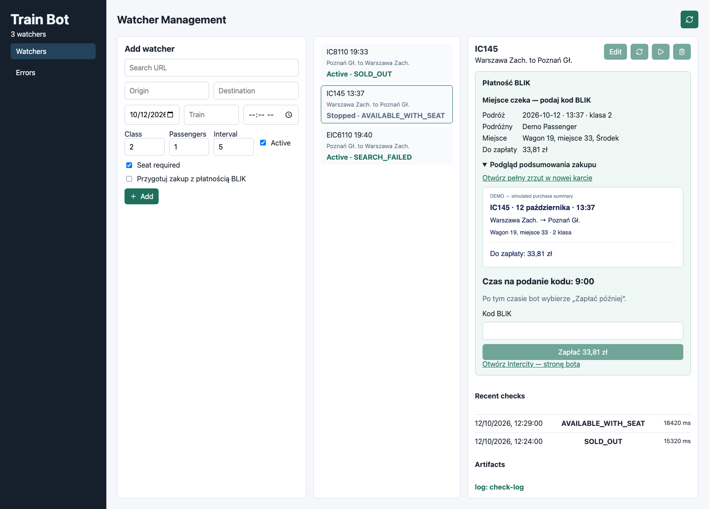

# Train Bot

A private PKP Intercity seat monitor with a React dashboard, email alerts and
optional BLIK checkout. Watch a specific train using its Intercity search URL;
the bot checks for an assigned seat and keeps its history in PostgreSQL.

- **Notification mode:** find a seat, optionally add the ticket to the cart and
  email the journey details. This is the default mode.
- **BLIK mode:** prepare checkout, retain the browser and accept a code from the
  dashboard. The bot clicks **PŁACĘ**; you confirm in your banking app.
- **Browser control:** access the bot's existing Intercity page from another
  device, with clicks, text entry, scrolling and explicit control takeover.
- **Diagnostics:** inspect check history, screenshots, logs and errors.

The backend uses TypeScript, Node.js, Playwright (Firefox in headless mode),
Prisma, PostgreSQL and Resend. The dashboard uses React and Vite. Run one backend per Intercity account;
checks run sequentially and pause while a purchase session is active.

## Dashboard preview

Actual dashboard with demonstration data; no real passenger, payment code or
booking is shown. See the [full gallery](dashboard/README.md#screenshots).





## Quick start with Docker

Requirements: Docker with Docker Compose and a configured Resend sender. BLIK
checkout also needs your Intercity account credentials.

```bash
cp .env.example .env
# Fill in RESEND_API_KEY, EMAIL_FROM, EMAIL_TO and Intercity credentials.
docker compose up -d --build
```

| Service | Local address |
| --- | --- |
| Dashboard | http://localhost:5173 |
| Bot API | http://localhost:3001 |
| PostgreSQL | localhost:5432 |

Open the dashboard, paste an Intercity search URL and select the matching train,
departure, class and passenger count. Add a notification watcher, or enable
**Przygotuj zakup z płatnością BLIK** and its consent checkbox. Watchers are
managed through the dashboard/API and stored in PostgreSQL. The example JSON
is a reference and is not imported at startup.

Docker applies migrations on startup. Named volumes retain database records and
artifacts. Deleting a watcher also removes its stored artifact files.

```bash
docker compose logs -f bot-api
docker compose down
```

Stopping or restarting the backend ends its live browser sessions. Avoid doing
this while a purchase awaits payment or confirmation.

## BLIK checkout

1. The bot finds an assigned seat, stops that watcher and opens payment using the
   configured account's passenger name, without invoice or donation.
2. Open the emailed dashboard link, review the passenger, seat, amount and summary
   screenshot, enter a fresh six-digit BLIK code and click **Zapłać**.
3. The bot enters the code, waits for an active **PŁACĘ** button and clicks once.
   Confirm in your banking app; only Intercity's success message confirms purchase.

The initial code deadline is twelve minutes from reservation start, or earlier
when Intercity's clock allows less time. Preparation and email delivery consume
that same window. At the deadline, an idle checkout selects **Zapłać później** and
confirms **Przejdź do oczekujących na płatność**. After confirmed deferral, the
browser remains open and the dashboard can reopen the same order for BLIK.
Deferral does **not** guarantee another fifteen minutes: the displayed Intercity
deadline determines the remaining time.

**Otwórz Intercity — stronę bota** opens the retained browser instead of a new
Intercity session on your device. One device controls it at a time; another can
take over. Closing the dashboard does not close that browser. A backend/browser
restart loses the session and marks an active purchase `UNKNOWN`; inspect the
order before explicitly resuming its watcher.

BLIK codes are not stored in database records, logs or artifacts. Text inputs
are masked in the live view. Timeouts do not trigger automatic repeat payments.
See [BLIK checkout details](docs/blik_purchase.md).

## Access from a phone

Use a trusted local network. Set `DASHBOARD_URL` in `.env` to your computer's LAN
address, for example `http://192.168.1.100:5173`, before starting the backend.
Open that address on a phone connected to the same network. Email links will use
it too. The dashboard normally calls the same hostname on port `3001`, so that
port must also be reachable. The API has no user authentication; this setup is
intended for private use on a trusted network, not public Internet access.

## Local development

Use Node.js 22.12 or newer, npm and PostgreSQL. From the repository root:

```bash
cp .env.example .env
npm ci
npm --prefix dashboard ci
docker compose up -d postgres
npm run prisma:generate
npm run db:deploy
npm run dev
```

Start the dashboard in a second terminal:

```bash
npm --prefix dashboard run dev
```

The example database URL connects to PostgreSQL on port `5432`. Docker overrides
it to its internal `postgres` hostname. Do not run the Docker bot and a development
backend against the same Intercity account simultaneously.

## Checks and useful commands

```bash
npm test
npm run build
npm --prefix dashboard run build
npm run test:browser
```

Browser tests use local payment fixtures and require a built dashboard; they do
not place orders or contact a bank. PostgreSQL tests use a separate test database.
See the [test guide](tests/README.md).

| Command | Purpose |
| --- | --- |
| `npm start` | Run the compiled backend after building and applying migrations |
| `npm run db:deploy` | Apply committed migrations |
| `npm run db:migrate` | Create/apply a development migration |
| `npm run check:once` | Check active notification watchers once; refuses BLIK watchers and active purchases |
| `npm run notify:test` | Send a real test email through configured Resend settings |

## Documentation

| Directory | Guide |
| --- | --- |
| [dashboard](dashboard/README.md) | UI, development, screenshots and remote control |
| [src](src/README.md) | Backend modules, request flow and API |
| [config](config/README.md) | Environment settings and watcher examples |
| [prisma](prisma/README.md) | Models, migrations and checkout lock |
| [tests](tests/README.md) | Unit, browser and PostgreSQL verification |
| [docs](docs/README.md) | Documentation index and screenshot regeneration |
