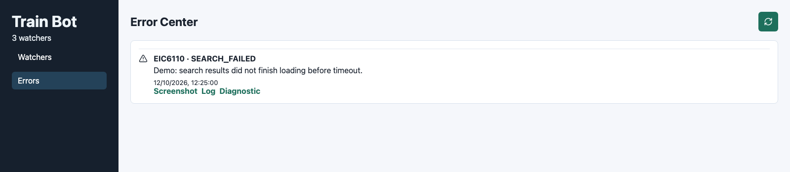
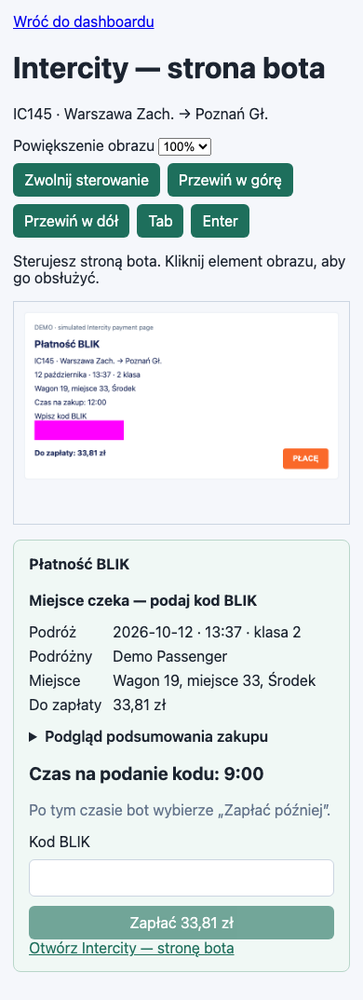

# Dashboard

React + Vite interface for watcher management, check history, errors and BLIK
payments. General setup is in the [project README](../README.md).

## Development

From the repository root:

```bash
npm --prefix dashboard ci
npm --prefix dashboard run dev
npm --prefix dashboard run build
npm --prefix dashboard run preview
```

Development uses port `5173`. The API URL defaults to the page's hostname on port
`3001`. `VITE_API_BASE_URL` overrides it at build/dev startup and is also a Docker
build argument. Rebuild when changing a compiled API URL. Docker serves the built
dashboard through nginx.

## Views and controls

| Entry point | Responsibility |
| --- | --- |
| `src/main.tsx` | Watcher form/list, history, artifacts, error center and routing |
| `src/PurchasePanel.tsx` | Purchase details, countdown, summary and BLIK submission |
| `src/RemoteBrowser.tsx` | Retained page, controller lease, input editor, scrolling and zoom |
| `src/api.ts` | API calls, DTOs, artifact URLs and attempt identifiers |

`/?watch=<watch ID>` selects a watcher. `/?watch=<watch ID>&view=intercity`
opens the bot's retained browser. A normal Intercity link on another device
does not share this session.

Purchase details refresh every two seconds and the countdown uses server time.
The live page refreshes once per second while visible. **Włącz sterowanie**
enables control; **Przejmij sterowanie** takes over from another device. Text
fields open an editor; **Wpisz na stronie bota** transfers the value. Inputs
are masked in streamed images. A 30-second lease is renewed every ten seconds
while visible. Closing the view releases control but leaves checkout running.
Pending payment is view-only.

Native **PŁACĘ** clicks and Enter use the same validated submission path as the
dashboard form. Confirmation still happens in the banking app. See
[BLIK states and deadlines](../docs/blik_purchase.md).

## Screenshots

Actual UI with demonstration data. The mobile view contains a local simulation
of Intercity, not a real reservation. See [regeneration instructions](../docs/README.md#regenerate-screenshots).

### Watcher management


### BLIK and purchase summary


### Error center



### Mobile browser control



## Verification

Build the dashboard before running `npm run test:browser` from the root.
See [tests](../tests/README.md) for HTTP-handler and PostgreSQL integration.
